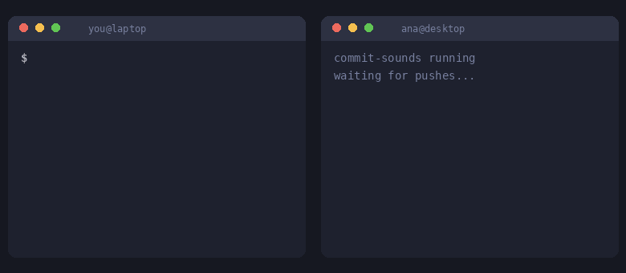

# 🔊 commit-sounds

**You `git push` → your friends' PCs play your sound.**
They push → your PC plays theirs.


<p align="center">
  
</p>

No server, no account, no IPs to exchange. Works on the same network (Wi-Fi/LAN).

## Install (1 minute)

```bash
git clone https://github.com/EduardoMilani8/commit-sounds ~/commit-sounds
cd ~/commit-sounds
bash install.sh
```

The installer asks three things:

| Question | Answer |
|----------|--------|
| Nickname | how your friends see you (`vini`) |
| Room code | the code a friend sent you, or **Enter** to create a new room |
| Your sound | e.g. `~/Downloads/laugh.mp3` |

Done. `git push` in any repository and listen.

## Invite a friend

1. Run `commit-sounds room` and send them the code (e.g. `frog-blue-7k2mpq`).
2. They install and paste it. They show up for everyone automatically.

## Commands

| Command | What it does |
|---------|--------------|
| `commit-sounds` | shows who in the room is online |
| `commit-sounds test` | plays your sound on your friends' PCs now |
| `commit-sounds test --here` | plays your sound on this PC |
| `commit-sounds sound ~/new.mp3` | changes your sound |
| `commit-sounds mute [min]` | silences everything (default 60 min); `mute off` to undo |
| `commit-sounds room` | shows the room code |
| `commit-sounds add <ip>` | adds a friend by IP if discovery fails |
| `commit-sounds remove <nickname>` | forgets a friend |
| `commit-sounds setup` | redo nickname, room and sound |

## How it works

- Each PC runs a small background service (systemd user unit) that announces
  itself on the network over UDP every 30 s.
- A global `pre-push` hook notifies your friends **in the background**: your
  push is never slowed down or blocked.
- If a friend doesn't have your sound yet, they download it straight from
  your PC on the spot.
- Everything is signed with a key derived from the room code: without the
  code, nobody can play anything.

## About the sound

- `mp3, wav, ogg, opus, flac, m4a, aac`, up to 5 MB.
- Plays for at most **5 seconds**.
- `.mp3` needs `ffmpeg` on the listener's PC (the installer installs it).

## Troubleshooting

Run `commit-sounds` and `commit-sounds test`: every error comes with a hint.

| Symptom | What to do |
|---------|------------|
| No friends in the room | Check the room code is the same. If your router blocks broadcast, use `commit-sounds add <ip>` |
| `could not connect` | Friend's PC is off, on another network, or its firewall is closed (`sudo ufw allow 8008`) |
| `clock out of sync` | Wrong date/time on one of the PCs (more than 10 min apart) |
| `played`, but nobody heard it | Friend's volume; they can try `commit-sounds test --here` |
| `Service: STOPPED` | `systemctl --user restart commit-sounds` and `journalctl --user -u commit-sounds -n 30` |
| `command not found` | Open a new terminal (the command lives in `~/.local/bin`) |

## Limitations

- Linux only, same network only.
- The notice goes out before the remote accepts the push, so a rejected push plays too.
- The global hook (`core.hooksPath`) makes git ignore each repo's `.git/hooks`.
- Anyone with the room code can play a sound on everyone in the room. Keep it within your group.

## Files

Everything lives in `~/.commit-sounds/` (config, your sound, friends, cache)
and the hook in `~/.git-hooks/pre-push`. Default port **8008** (TCP and UDP);
the whole room must use the same one.

## Contributing

Issues and PRs are welcome. The project is a single Python file (stdlib only)
with no build step and no dependencies.

## License

[MIT](LICENSE)
